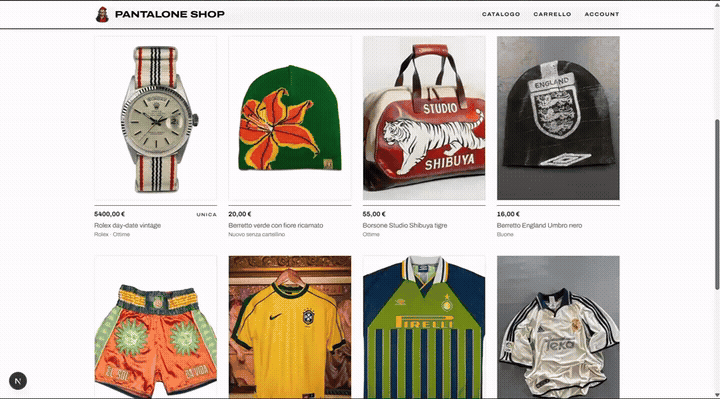
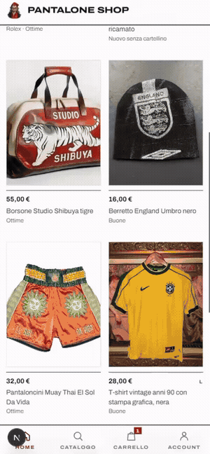

[README.md](https://github.com/user-attachments/files/33225178/README.md)

# Pantalone Shop #

E-commerce di abbigliamento vintage e second-hand, dove ogni capo è un **pezzo unico**.
Ho progettato e sviluppato il sito da solo, dalla UI/UX al database e ai pagamenti, per una start-up nata su Vinted che si sta spostando sul proprio sito.

## Demo

| Desktop | Mobile |
|:---:|:---:|
|  |  |
| [▶ Video completo desktop](LINK_VIDEO_DESKTOP) | [▶ Video completo mobile](LINK_VIDEO_MOBILE) |

## Funzionalità

**Catalogo**
- Ricerca testuale e filtro per categoria (accessori, camicie, giacche, jeans, scarpe…)
- Filtri per taglia, brand e condizione; ordinamento per ultimi arrivi e prezzo
- Sezioni "Ultimi arrivi" e "Continua a guardare" (pezzi visti di recente)
- Skeleton loading durante il caricamento delle pagine

**Scheda prodotto**
- Galleria immagini, condizione, brand, taglia e categoria
- Misure reali del capo in cm
- "Compra ora" o "Aggiungi al carrello"

**Carrello e checkout**
- Gestione della disponibilità dei pezzi unici: il carrello non blocca il capo, che viene riservato per 30 minuti solo all'avvio del pagamento
- Checkout con indirizzi di spedizione salvati e riepilogo dell'ordine
- Pagamento con Stripe Checkout (carta, PayPal, Apple Pay)
- Email transazionali con Resend

**Account utente**
- Storico ordini con stato e tracking
- Carrello salvato e cambio password

**Design**
- Interfaccia responsive, con barra di navigazione inferiore su mobile e badge del carrello
- Pagine informative: spedizioni, resi e recesso, termini di vendita, privacy

## Tecnologie
| Area | Strumento |
|---|---|
| Frontend | Next.js (React) |
| Database e autenticazione | Supabase (PostgreSQL) |
| Pagamenti | Stripe Checkout |
| Email | Resend |
| Hosting | Vercel |

## Il mio ruolo
Ho curato l'intero progetto da solo:
- **UI/UX:** struttura delle pagine, identità visiva e versione mobile
- **Database:** modellazione di prodotti, ordini e utenti su Supabase
- **Pagamenti:** integrazione Stripe e logica di riserva dei pezzi unici
- **Email:** notifiche d'ordine con Resend
